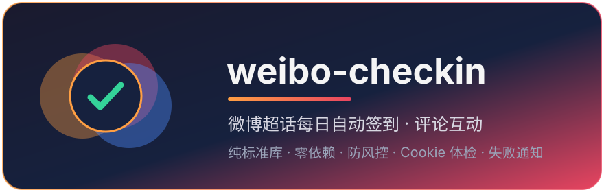

<div align="center">



# 🤖 weibo-checkin

**微博超话每日自动签到 + 评论的小脚本**

[](LICENSE)
[]()
[](https://github.com/88lin/weibo-checkin/stargazers)
[](https://dev.88lin.eu.org/)

一个自包含的 Python 脚本（纯标准库，零依赖），每天自动帮你完成微博超话签到和评论互动。只读取你自己抓的登录 Cookie，零内置密钥，不碰账号密码，可安全分享。

👤 作者：[茉灵智库 · 88lin](https://dev.88lin.eu.org/) · 📦 [github.com/88lin/weibo-checkin](https://github.com/88lin/weibo-checkin)

</div>

> [!TIP]
> 超话接口系从网页版逆向所得，服务端改一版就可能失效——修复都会推到本仓库。顺手点个 ⭐ Star，等哪天签到莫名断了，你能一秒把它找回来。

## ✨ 功能

- ✅ 超话**每日签到**（支持多个超话，自动从搜索解析超话 ID）
- 💬 超话内**自动评论**（语料池随机抽取，不撞车）
- 🛡️ **防风控**：启动时间抖动（错开整点）、随机请求间隔、随机超话顺序、指数退避重试
- 🩺 **Cookie 体检**：自动解析过期时间，提前 7 天告警，失效立刻通知而不是每天空跑
- 🔕 **失败隔离**：单个超话出问题不影响其他超话
- 📣 **Webhook 通知**：Server酱 / Bark / 企业微信机器人，配个 URL 就行
- 📊 `status` 命令：最近 14 天成功率 + 全胜连签天数
- 🧪 `--dry-run`：演练模式，走完整流程但不动真格

## 🤖 AI 一键配置（推荐）

把下面的提示词连同仓库链接直接发给你的 AI 助手（WorkBuddy / Hermes / Claude 等），它会自己 clone、填配置、装好定时任务：

```text
帮我部署微博超话自动签到脚本，要求：
1. clone https://github.com/88lin/weibo-checkin.git 到本地
   （网络慢或连不上时改用镜像前缀：git clone https://ghfast.top/https://github.com/88lin/weibo-checkin.git）
2. 建好 config.json（参考 config.example.json），cookie 字段留空，超话和评论语料先按默认
3. 跑 python3 weibo_checkin.py check 确认脚本能正常启动（会提示缺 Cookie，属正常）
4. 按系统装好每日定时任务：
   - Linux/macOS: crontab，每天 9:30，用 silent 模式
   - Windows: 任务计划程序，每天 9:30，pythonw.exe + silent 模式
5. 最后告诉我：还需要我手动做哪一步（只有一件事：把 Cookie 粘进 config.json）
```

> [!NOTE]
> 整个流程只有 **Cookie 需要你手动提供**（登录 weibo.com → F12 → Network → 任意请求 → 复制请求头里的 `Cookie` 值）。AI 拿不到你的浏览器登录态，也不要把密码给任何工具。

## 🚀 手动部署

```shell
git clone https://github.com/88lin/weibo-checkin.git
cd weibo-checkin
# 国内网络慢或连不上时，用镜像前缀：
# git clone https://ghfast.top/https://github.com/88lin/weibo-checkin.git
cp config.example.json config.json
```

编辑 `config.json`：

| 字段 | 说明 |
|---|---|
| `cookie` | 浏览器登录 weibo.com → F12 → Network → 任意请求 → 复制请求头里的完整 `Cookie` 值 |
| `supertopics` | 要签到的超话名列表，如 `["数码", "小米"]` |
| `comments` | 评论语料池（每次随机抽一条）；留空 `[]` 则只签到不评论 |

先体检一次（只读，不写操作）：

```shell
python3 weibo_checkin.py check
```

看到 `✓ 有效` 和各超话 ID 就能正式跑了：

```shell
python3 weibo_checkin.py run
```

## ⏰ 每日定时

### Linux / macOS · crontab

```shell
crontab -e
# 每天 9:30（脚本内部还会再随机抖动 0~20 分钟）
30 9 * * * cd /path/to/weibo-checkin && /usr/bin/python3 weibo_checkin.py silent >> cron.log 2>&1
```

### macOS · launchd（推荐，比 cron 更 macOS）

cron 在 macOS 上是二等公民（合盖休眠会直接错过、不补跑；新版系统还会弹"完全磁盘访问"授权坑）。推荐用 launchd：

```shell
# 1. 复制示例配置并改两处路径（文件顶部注释有说明）
cp com.weibo.checkin.plist.example ~/Library/LaunchAgents/com.weibo.checkin.plist
open -e ~/Library/LaunchAgents/com.weibo.checkin.plist

# 2. 加载并验证
launchctl load ~/Library/LaunchAgents/com.weibo.checkin.plist
launchctl list | grep weibo   # 有输出即装好
```

特点：**合盖/关机错过的任务，开机登录后自动补跑**（配合脚本自身的幂等设计，补跑只会返回"今日已签"，不会重复签到）。

### Windows · 任务计划程序

创建基本任务 → 每天 9:30 → 启动程序：

- 程序：`pythonw.exe`（**静默关键**：无窗口；用 `python.exe` 会每天弹黑框）
- 参数：`weibo_checkin.py silent`
- 起始于：脚本所在目录（**必须填**，否则找不到 config.json）

> [!TIP]
> 想要"错过后开机补跑"：任务属性 → 设置 → 勾选 **"错过后尽快启动任务"**（默认最多延迟补跑 1 小时内）。配合脚本幂等，补跑安全。

## 🏠 关于在哪台机器跑

**推荐跑在每天使用的电脑上，而不是云服务器 / GitHub Actions**：

| | 家用电脑（推荐） | 云服务器 / Actions |
|---|---|---|
| IP 类型 | 住宅 IP，微博风控宽容 | 数据中心 IP，高危名单，易触发验证码/风控 |
| 稳定性 | 每天开机就在 | Actions 定时经常延迟 10~40 分钟 |
| 凭据安全 | Cookie 只在你自己机器 | 需要上传到第三方 Secrets |

本脚本有意**不做** GitHub Actions 模式，就是这个原因。

## 📖 全部命令

| 命令 | 干什么 |
|---|---|
| `run` | 签到 + 评论（默认，定时任务用） |
| `run --no-comment` | 只签到不评论 |
| `run --dry-run` | 演练：全流程走一遍但不真正签到/评论 |
| `silent` | 同 `run`，结果只写 `weibo.log`（配合 pythonw / cron 静默） |
| `check` | 体检：Cookie 有效期 + 登录态 + 超话解析预览，零写操作 |
| `status` | 最近 14 天成功率 + 全胜连签天数 |

## 📣 通知（可选）

`config.json` 里：

```json
"notify": {
  "enabled": true,
  "url": "https://sctapi.ftqq.com/你的KEY.send"
}
```

任何形式的 **POST JSON `{"title": ..., "desp"/"content": ...}`** 都兼容：Server酱、Bark（`https://api.day.app/你的KEY`）、企业微信机器人 webhook 等。只在**失败或 Cookie 快过期**时推送，成功不打扰。

## 🛡️ 防风控设计

| 措施 | 说明 |
|---|---|
| 启动抖动 | 每次运行先随机睡 0~20 分钟，避免每天同一秒打点（`jitter_minutes` 可调） |
| 随机间隔 | 每个请求之间随机睡 5~15 秒（`delay_min/delay_max` 可调） |
| 随机顺序 | 多个超话每次打乱顺序处理 |
| 指数退避 | 网络错误自动重试 3 次（4s → 16s → 64s） |
| X-Xsrf-Token | 自动从 Cookie 提取并回传，微博网页版的防 CSRF 机制，缺了评论必 403 |
| 失败隔离 | 单个超话解析/签到失败不影响其他超话 |

## ⚠️ 注意

- `config.json` 含登录凭证，已被 `.gitignore` 排除，**切勿手动提交或分享**
- Cookie 有效期一般几周到几个月（`check` 命令会告诉你确切日期），过期重抓一次即可
- 评论语料建议自己改写，避免和别人撞车
- 仅供个人学习，请勿高频滥用（账号被限制概不负责）

## License

MIT
